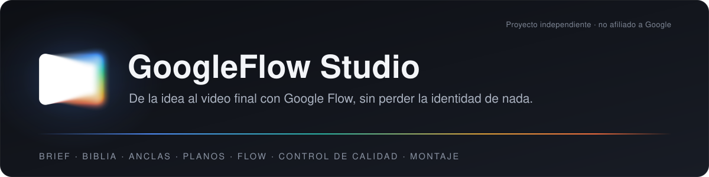
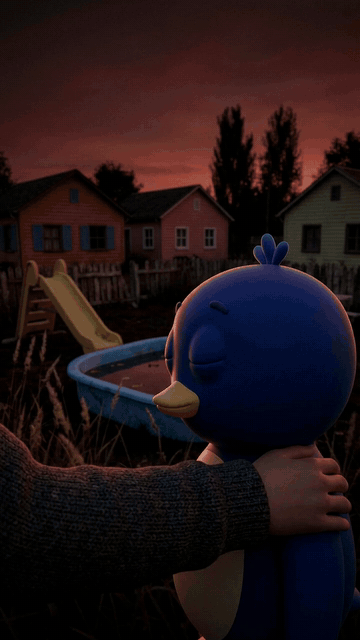
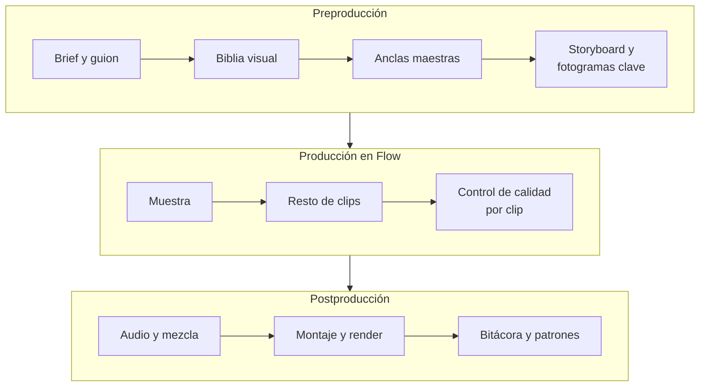

<div align="center">



[](LICENSE)
[](requirements.txt)
[](https://ffmpeg.org/)
[](SKILL.md)

**Una skill de producción audiovisual que convierte una idea en un video hecho con Google Flow,<br>con personajes, lugares y productos idénticos de principio a fin.**

[Demostración](#demostración) · [Cómo funciona](#cómo-funciona) · [Instalación](#instalación) · [Uso](#uso) · [Limitaciones](#compatibilidad-y-limitaciones)

</div>

## Por qué existe

Generar clips sueltos con IA es fácil. Lo difícil es que el personaje sea el mismo en todos, que los planos encajen sin saltos, que el sonido acompañe y que el gasto no se dispare. GoogleFlow Studio aplica a Google Flow el proceso de una producción real: preproducción, producción con control de calidad por clip y postproducción. Cada decisión se aprueba en imagen antes de gastar en video.

> **Principio central: se decide en imagen, se anima en video.** Las imágenes de Flow (Nano Banana) no consumen puntos y el video sí. Por eso la identidad de cada personaje, lugar y producto, y el primer fotograma de cada plano, se resuelven como **imágenes ancla** aprobadas antes de generar un solo clip.

## Demostración

<div align="center">


<sub>Fragmento real de «La piscina azul» (6,5 s de 31,8 s), producido de principio a fin con esta skill.</sub>
</div>

Este fragmento sale de un video de 31,8 s, una toma continua en primera persona formada por **6 clips de Omni Flash 1.2** encadenados por fotogramas clave. Las uniones entre clips no se ven. Datos registrados por la propia skill en `bitacora.jsonl` y `costos.md`:

| | La piscina azul | El puffle que dejaste |
| --- | --- | --- |
| Duración final | 31,79 s · 1080×1920 · 30 fps | 20,87 s · 1080×1920 · 30 fps |
| Clips aprobados | 6 (23 generaciones en total) | 4 (17 generaciones) |
| Puntos de Flow | 340 medidos, igual que los declarados | 177 medidos, igual que los declarados |
| Imágenes ancla y fotogramas clave | 0 puntos (Nano Banana) | 0 puntos |
| Sonoridad final | −14,1 LUFS · −1,7 dBTP | −14,1 LUFS · −1,2 dBTP |

> [!NOTE]
> Los dos videos de demostración son contenido de fans sin fines comerciales. Los personajes de *The Backyardigans* pertenecen a Nickelodeon y los de *Club Penguin*, a Disney. Google Flow, Veo y Nano Banana son marcas de Google. Este proyecto no tiene relación con ninguna de esas empresas.

## Cómo funciona



Al cerrar cada video, la bitácora alimenta los patrones probados que la siguiente preproducción lee antes de planificar. Cada etapa termina en una **puerta de aprobación**. Nada avanza sin la palabra explícita del usuario, y cada aprobación queda registrada con sus propias palabras en `BRIEF.md`.

| Puerta | Qué se presenta | Qué autoriza |
| --- | --- | --- |
| 1 | Brief y guion | Crear el proyecto y la biblia visual |
| 2 | Biblia y anclas maestras | Derivadas y fotogramas clave (0 puntos) |
| 3 | Storyboard, fotogramas clave y estimación de puntos | La muestra: los 1–2 planos más difíciles |
| 4 / 4b | Cada clip por separado, con su hoja de control de calidad | Unir los clips, generar el audio y montar |
| 5 | Montaje completo | Exportación final |

## Funcionalidades

- **Sistema de imágenes ancla.** Jerarquía maestra → derivada → fotograma clave → relevo (último fotograma del clip anterior). Hay referencias solo de estilo y fotogramas derivados unos de otros para que el inicio y el fin de cada clip compartan luz y fondo.
- **Biblia visual como fuente de verdad.** Estilo, paleta, iluminaciones, personajes (humanos, criaturas o animados), lugares y productos. Se pega literal en cada prompt y nunca se resume como «igual que antes».
- **Prompts para Flow generados y validados.** `flowprompt.py` comprueba los límites de cada modelo, las duraciones, que la suma de tiempos cuadre, las referencias vagas, el texto que se cuela y los colores en hex o Kelvin. Con eso escribe `PROMPTS.md` listo para copiar.
- **Control de calidad por clip.** `qc_clips.py` detecta cortes internos, parpadeos, congelados, saltos de luz sin corte y deriva de color, y mide la fidelidad al fotograma clave. Genera la hoja de revisión y extrae el último fotograma para el relevo.
- **Audio.** Voces, efectos y música con ElevenLabs, y mezcla a −14 LUFS con ducking, pico real ≤ −1 dBTP y filtros por capa. Las voces van con un protocolo propio: se pregunta antes, se usa una sola frase por defecto y se audita una muestra de audio antes de mezclarla.
- **Costes bajo control.** `costos.py` registra los puntos de Flow por etapa (declarados y medidos por el saldo), los tokens de Claude y los créditos de ElevenLabs.
- **Aprendizaje entre proyectos.** `bitacora.jsonl` registra cada generación. Los aciertos y fallos con evidencia se promueven a `assets/patrones/patrones-probados.md`, que la skill lee antes de planificar.

## Requisitos

| Componente | Necesario para | Verificado con |
| --- | --- | --- |
| [Claude Code](https://docs.claude.com/en/docs/claude-code) | Usar la skill (dirección, puertas, decisiones) | Claude Code (app de escritorio, Windows 11) |
| Python 3.10+ con `numpy` y `Pillow` | Todos los scripts | Python 3.10.22 y 3.14.8 |
| FFmpeg y FFprobe en el `PATH` | Control de calidad, audio y montaje | FFmpeg 9.0.1 |
| Cuenta de [Google Flow](https://labs.google/flow) | Generar imágenes y clips | Plan Google AI Pro |
| Clave de ElevenLabs *(opcional)* | Voces, efectos y música generados | API v1 |
| OpenCV 4 *(opcional)* | `qc_clips.py --caras` | `opencv-python-headless<5` |
| motion-studio *(opcional, externa)* | Montaje, render y exportación final | No incluida en este repositorio |

## Instalación

1. Clona la skill en tu carpeta de skills de Claude Code. Puede ser personal (`~/.claude/skills/`) o de un proyecto (`<proyecto>/.claude/skills/`):

   ```bash
   git clone https://github.com/Dvanielx03/googleflow-studio.git ~/.claude/skills/googleflow-studio
   ```

2. Instala las dependencias de Python:

   ```bash
   pip install -r ~/.claude/skills/googleflow-studio/requirements.txt
   ```

3. Comprueba que FFmpeg está en el `PATH` y ejecuta las pruebas. No consumen puntos de Flow ni créditos de ElevenLabs:

   ```bash
   ffmpeg -version
   python ~/.claude/skills/googleflow-studio/scripts/probar.py
   ```

   El resultado esperado termina en `TODO OK`.

### Clave de ElevenLabs (opcional)

La clave se lee, en este orden, de la variable `ELEVENLABS_API_KEY`, del archivo indicado en `ELEVENLABS_ENV` o de `~/.config/googleflow-studio/elevenlabs.env`:

```bash
mkdir -p ~/.config/googleflow-studio
echo "ELEVENLABS_API_KEY=tu_clave" > ~/.config/googleflow-studio/elevenlabs.env
python scripts/elevenlabs.py saldo .
```

> [!IMPORTANT]
> La clave nunca se imprime ni se guarda en el proyecto, y `.gitignore` excluye cualquier archivo `.env`. No la subas al repositorio.

## Uso

### Con Claude Code

La skill se activa sola cuando pides un video para Google Flow, aunque no la nombres:

```text
Quiero un reel vertical de unos 30 segundos hecho en Google Flow: un personaje que
vuelve al patio de su infancia al atardecer. Esta es la referencia de estilo: <enlace>
```

A partir de ahí la skill:

1. analiza la referencia segundo a segundo;
2. propone conceptos;
3. avanza puerta por puerta (biblia, anclas, storyboard, muestra, clips, audio y montaje);
4. te presenta cada clip y cada muestra de audio antes de seguir.

Puedes generar tú los prompts en Flow o, si lo pides y tienes un navegador con tu sesión, puede hacerlo el agente dentro del alcance aprobado.

### Con los scripts

Todos aceptan `--help`. Este recorrido usa el proyecto de ejemplo incluido, `cafe-origen`, con un personaje, un lugar, un producto y tres planos:

```bash
cd ~/.claude/skills/googleflow-studio

# 1. Crear un proyecto a partir del ejemplo completo
python scripts/nuevo_proyecto.py ~/videos/demo --ejemplo

# 2. Validar biblia, anclas y plan; generar prompts, biblia y storyboard
python scripts/flowprompt.py validar ~/videos/demo
python scripts/flowprompt.py prompts ~/videos/demo        # → 04-prompts/PROMPTS.md
python scripts/flowprompt.py storyboard ~/videos/demo     # → 03-storyboard/STORYBOARD.md

# 3. Revisar un clip descargado de Flow
python scripts/qc_clips.py ~/videos/demo P01 ~/videos/demo/05-clips/raw/P01_v1.mp4

# 4. Registrar la generación y ver el resumen del proyecto
python scripts/bitacora.py registrar ~/videos/demo --plano P01 --resultado aprobado --puntos 30
python scripts/bitacora.py resumen ~/videos/demo

# 5. Cuando 06-audio/sonido.json declare música, voces o el sonido de los clips:
#    generar lo que falte con ElevenLabs y mezclar a −14 LUFS
python scripts/elevenlabs.py generar ~/videos/demo
python scripts/elevenlabs.py mezclar ~/videos/demo --duracion 15
```

Cada proyecto de video tiene esta estructura:

```text
<video>/
├── BRIEF.md            # idea, decisiones y aprobaciones con las palabras del usuario
├── 01-biblia/          # biblia.json → BIBLIA.md
├── 02-anclas/          # anclas.json, maestras, fotogramas clave y relevos
├── 03-storyboard/      # plan.json → STORYBOARD.md
├── 04-prompts/         # PROMPTS.md listo para Flow
├── 05-clips/           # raw/ y aprobados/
├── 06-audio/           # sonido.json, voces, efectos y música
├── 07-qc/              # hojas de revisión por clip y REVISION.md
├── 08-montaje/         # proyecto de montaje y exportaciones
├── bitacora.jsonl
└── costos.md
```

## Estructura del repositorio

```text
googleflow-studio/
├── SKILL.md                    # instrucciones de la skill: etapas, puertas y reglas
├── references/                 # guía de cada etapa (01 a 10)
├── assets/
│   ├── flow_capacidades.json   # modelos, modos y límites de Flow, con fecha de verificación
│   ├── patrones/               # patrones probados y antipatrones, con evidencia
│   ├── plantilla/              # plantillas de un proyecto nuevo
│   ├── ejemplo/cafe-origen/    # proyecto de ejemplo completo
│   └── kit/flow_montaje.js     # ayudante de montaje para motion-studio
├── scripts/                    # herramientas de línea de comandos (Python)
├── docs/media/                 # banner y GIF de demostración
├── requirements.txt
└── LICENSE
```

## Pruebas

`scripts/probar.py` ejecuta 39 comprobaciones con material sintético generado por FFmpeg. Usa una carpeta temporal y no llama a Flow ni a ElevenLabs. Cubre:

- validación de prompts y planes;
- detección de cortes, parpadeos, congelados y saltos de luz;
- bitácora y costes;
- paso de los clips al montaje;
- mezcla a −14 LUFS;
- que la música siga sonando después de la última voz.

Se ha verificado en un clon limpio con Python 3.10.22, solo con las dependencias de `requirements.txt`: 39 de 39 correctas.

## Compatibilidad y limitaciones

- **Google Flow no tiene API pública.** Los prompts los ejecuta el usuario en Flow, o el agente desde un navegador con su sesión. La skill prepara, valida, revisa y registra, pero no genera clips por sí sola.
- **Flow cambia a menudo.** `assets/flow_capacidades.json` se verificó el 2026-11-11 con un plan Pro: Omni Flash 1.2 es el modelo principal, Veo 3.1 Fast y Quality se retiran el 2026-12-05 y en el modo Frames no existe la duración de 4 s. La skill pide volver a verificarlo si tiene más de un mes.
- **El montaje final depende de motion-studio**, otra skill que no se incluye aquí. Sin ella siguen funcionando la preproducción, los prompts, el control de calidad, la bitácora, los costes y la mezcla de audio. El render final del video necesita motion-studio o un editor propio.
- **El seguimiento de tokens** de `costos.py` lee los registros locales de Claude Code (`~/.claude/projects`).
- **Las comprobaciones de voz** con transcripción (faster-whisper) se describen en `references/06-produccion-audio.md`, pero no están empaquetadas como script.
- **Idioma.** Las instrucciones y la documentación de la skill están en español y los prompts para Flow se generan en inglés.
- **Sistema.** Solo se ha probado en Windows 11 (Git Bash y PowerShell). Los scripts usan solo la biblioteca estándar, `numpy`, `Pillow` y FFmpeg, pero en macOS y Linux no se han probado.
